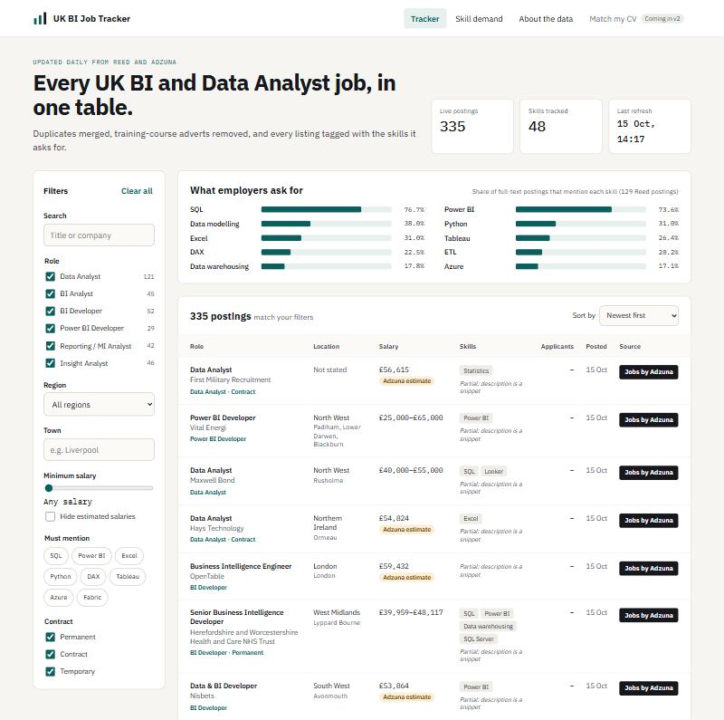
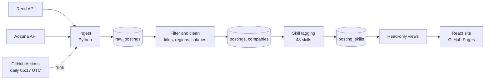

# UK BI Job Tracker

A self-updating tracker of UK Business Intelligence and Data Analyst job postings. Every morning it collects new postings, removes duplicates and training-course adverts, and tags each job with the skills it asks for.

**Live site:** https://njflora.github.io/uk-job-market-tracker/



## What it shows

- Every in-scope UK posting in one filterable table: role, region, town, salary, contract type and skills.
- What employers ask for: the share of postings that mention each of 48 tracked skills.
- Where each job came from, with a link to the original advert.

Early findings from the first 130 full-text postings (October 2026):

| Skill | Share of postings |
| --- | --- |
| SQL | 76% |
| Power BI | 73% |
| Data modelling | 38% |
| Excel | 32% |
| Python | 31% |
| Microsoft Fabric | 15% |

## How it works



1. **Ingest.** A GitHub Actions job runs every morning. It searches Reed and Adzuna for BI and data analyst titles.
2. **Store raw first.** Every API response is saved unchanged in `raw_postings`. A rule change can then be replayed over all past data without calling the APIs again (`python -m pipeline.rebuild`).
3. **Filter and clean.** Out-of-scope titles and training-course adverts are dropped. Locations are mapped to the 12 UK regions, salaries are converted to yearly figures, and company names are normalised.
4. **Deduplicate.** The same job on both sites, or under several towns, becomes one row. The key is company, title and region; every town is kept so the town filter still works.
5. **Tag skills.** Each posting is checked against 48 skills in 7 categories. Adzuna only provides a 500-character snippet, so skill figures use full-text Reed postings only.
6. **Serve.** The site reads two read-only database views through Supabase's public API. Row level security stops the public key from reading raw data or changing anything.

## Data quality decisions

| Problem found | Decision |
| --- | --- |
| One training provider made up at least 118 of the first 548 rows | Blocked by advertiser name as well as by title wording |
| The same job appeared under several towns or postcodes | Deduplicate by region; keep every town in a list |
| Adzuna descriptions stop at 500 characters | Skill figures use Reed postings only |
| Adzuna sometimes estimates a salary | Shown with an "Adzuna estimate" label |
| Reed sometimes gives hourly or daily rates | Converted to yearly figures |

Full details: [field mapping](docs/FIELD_MAPPING.md), [skills](docs/SKILLS.md), [decisions](docs/DECISIONS.md), [changelog](docs/CHANGELOG.md).

## Tech stack

| Layer | Tool |
| --- | --- |
| Ingestion and cleaning | Python (requests, psycopg) |
| Database | PostgreSQL on Supabase |
| Scheduling | GitHub Actions |
| Front end | React with Vite |
| Hosting | GitHub Pages |

## Repository layout

```text
pipeline/       Python: sources, cleaning, tagging, loading
sql/migrations/ Database schema, run in order
frontend/       React site
scripts/        One-off test scripts
docs/           Field mapping, skills, decisions, changelog
.github/        Daily ingest and site deploy workflows
```

## Running it yourself

1. Create a Supabase project and run the files in `sql/migrations/` in order.
2. Register for free Reed and Adzuna API keys.
3. Copy `.env.example` to `.env` and fill in the four values.
4. Install and run:

```
python -m venv .venv
.venv\Scripts\activate
pip install -r requirements.txt
python -m pipeline.run
```

## Roadmap

- **v2: Match my CV.** Read a CV in the browser, compare its skills with each role type, and show which skills are missing. The CV never leaves the visitor's computer.
- **Gap-to-project library.** For each missing skill, a small project to close the gap.

## Data sources

Jobs by [Adzuna](https://www.adzuna.co.uk). Powered by [Reed](https://www.reed.co.uk). Postcode lookups by [postcodes.io](https://postcodes.io).
